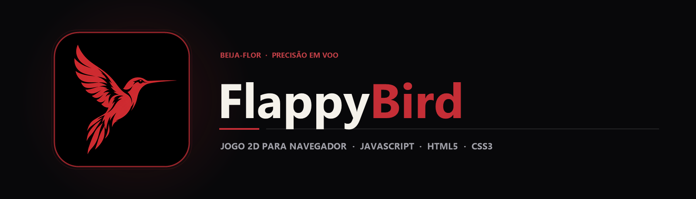

  

  Recriação do clássico arcade Flappy Bird diretamente no navegador com física de gravidade, geração contínua de obstáculos e detecção de colisão em JavaScript.

  
  
  

## Sobre o projeto

Jogos 2D em tempo real exigem um loop de atualização consistente, controle de velocidade vertical (gravidade vs. impulso), criação dinâmica de obstáculos e verificação contínua de caixas de colisão (*bounding boxes*). Este projeto recria a mecânica do **Flappy Bird** utilizando **HTML5, CSS3 e JavaScript puro**, sem depender de engines externas.

Todos os recursos gráficos clássicos — cenário de fundo, pássaro, canos superiores e inferiores, logotipo e tela de *Game Over* — estão organizados localmente na pasta Flappy-Bird-main/images/, permitindo executar o jogo imediatamente em qualquer navegador moderno.

## Principais recursos

| Recurso | Como funciona |
|---|---|
| Loop de jogo contínuo | Atualização quadro a quadro da posição vertical do pássaro e do deslocamento horizontal dos canos. |
| Física de voo e gravidade | Aceleração constante para baixo compensada pelo impulso instantâneo acionado pelo jogador. |
| Obstáculos dinâmicos | Pares de canos (	oppipe.png e ottompipe.png) gerados com aberturas variáveis ao longo da partida. |
| Detecção de colisão | Verificação geométrica entre as coordenadas do pássaro, os limites da tela e os canos ativos. |
| Sistema de pontuação | Incremento automático do placar a cada par de obstáculos superado com sucesso. |
| Fluxo de reinício | Tela de início com botão interativo e transição imediata para nova tentativa após o *Game Over*. |

## Tecnologias

  
  
  

- **JavaScript (script.js)** para o game loop, eventos de teclado/clique, física e placar;
- **HTML5 (index.html)** para estruturação do palco do jogo;
- **CSS3 (style.css)** para estilização, posicionamento e responsividade do container;
- **Sprites PNG** dedicados para todos os elementos visuais da partida.

## Arquitetura

`mermaid
flowchart LR
    A[Input do Jogador] --> B[Impulso Vertical]
    G[Gravidade Constante] --> C[Game Loop · script.js]
    B --> C
    C --> D[Atualização de Posição e Canos]
    D --> E{Colisão Detectada?}
    E -->|Não| F[Incrementa Placar e Renderiza]
    E -->|Sim| H[Tela de Game Over]
`

## Estrutura do repositório

`	ext
FlappyBird-Game/
├── assets/
│   ├── banner.png                      Banner principal do projeto
│   └── project-animal.png              Símbolo do beija-flor
├── Flappy-Bird-main/
│   ├── images/                         Sprites do pássaro, canos, cenário e UI
│   ├── index.html                      Página principal do jogo
│   ├── style.css                       Estilos e dimensões da área de jogo
│   └── script.js                       Motor de física, colisão e pontuação
└── README.md
`

## Executando o código

1. Clone o repositório:
   `ash
   git clone https://github.com/arthurlynow098/FlappyBird-Game.git
   `
2. Abra o arquivo Flappy-Bird-main/index.html diretamente no navegador (ou utilize a extensão *Live Server* no VS Code).
3. Pressione a tecla de espaço / seta para cima para controlar a altitude do pássaro e desviar dos canos.

## Decisões técnicas

- **Zero dependências externas:** toda a lógica de colisão e animação foi escrita em JavaScript nativo para manter o carregamento instantâneo e evidenciar os fundamentos da linguagem.

---

Estudo · construção · evolução <a href="https://github.com/arthurlynow098">Perfil</a> · <a href="https://arthurentsev.vercel.app/">Portfólio</a> · <a href="https://www.linkedin.com/in/entsevarthur/">LinkedIn</a>

