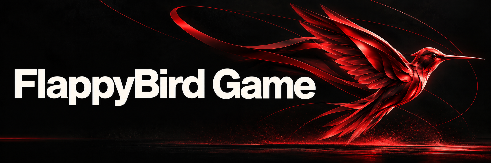
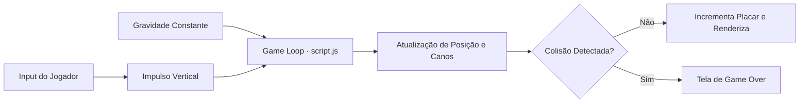

<p align="center">
  
</p>

<p align="center">Jogo de navegador inspirado em Flappy Bird, feito com JavaScript, HTML e CSS.</p>

<p align="center">
  
  
  
</p>

<p align="center"><a href="#visão-geral">Visão geral</a> &nbsp;·&nbsp; <a href="#recursos">Recursos</a> &nbsp;·&nbsp; <a href="#como-executar">Como executar</a></p>

---

## Visão geral

Todos os recursos gráficos clássicos — cenário de fundo, pássaro, canos superiores e inferiores, logotipo e tela de *Game Over* — estão organizados localmente na pasta Flappy-Bird-main/images/, permitindo executar o jogo imediatamente em qualquer navegador moderno.

## Recursos

| Recurso | Como funciona |
|---|---|
| Loop de jogo contínuo | Atualização quadro a quadro da posição vertical do pássaro e do deslocamento horizontal dos canos. |
| Física de voo e gravidade | Aceleração constante para baixo compensada pelo impulso instantâneo acionado pelo jogador. |
| Obstáculos dinâmicos | Pares de canos (toppipe.png e bottompipe.png) gerados com aberturas variáveis ao longo da partida. |
| Detecção de colisão | Verificação geométrica entre as coordenadas do pássaro, os limites da tela e os canos ativos. |
| Sistema de pontuação | Incremento automático do placar a cada par de obstáculos superado com sucesso. |
| Fluxo de reinício | Tela de início com botão interativo e transição imediata para nova tentativa após o *Game Over*. |

## Tecnologias

- **JavaScript (script.js)** para o game loop, eventos de teclado/clique, física e placar;
- **HTML5 (index.html)** para estruturação do palco do jogo;
- **CSS3 (style.css)** para estilização, posicionamento e responsividade do container;
- **Sprites PNG** dedicados para todos os elementos visuais da partida.

<details>
<summary>Arquitetura</summary>



</details>

<details>
<summary>Estrutura do repositório</summary>

```text
FlappyBird-Game/
├── assets/
│   └── project-animal.png          Emblema do projeto
├── Flappy-Bird-main/
│   ├── images/                         Sprites do pássaro, canos, cenário e UI
│   ├── index.html                      Página principal do jogo
│   ├── style.css                       Estilos e dimensões da área de jogo
│   └── script.js                       Motor de física, colisão e pontuação
└── README.md
```

</details>

## Como executar

1. Clone o repositório:
   ```bash
   git clone https://github.com/arthurlynow098/FlappyBird-Game.git
   ```
2. Abra o arquivo Flappy-Bird-main/index.html diretamente no navegador (ou utilize a extensão *Live Server* no VS Code).
3. Pressione a tecla de espaço / seta para cima para controlar a altitude do pássaro e desviar dos canos.

## Decisões técnicas

- **Zero dependências externas:** toda a lógica de colisão e animação foi escrita em JavaScript nativo para manter o carregamento instantâneo e evidenciar os fundamentos da linguagem.

---

<p align="center">
  <a href="https://github.com/arthurlynow098">GitHub</a> &nbsp;·&nbsp;
  <a href="https://arthurentsev.vercel.app/">Portfólio</a> &nbsp;·&nbsp;
  <a href="https://www.linkedin.com/in/entsevarthur/">LinkedIn</a>
</p>
