<a id="top"></a>

<p align="center">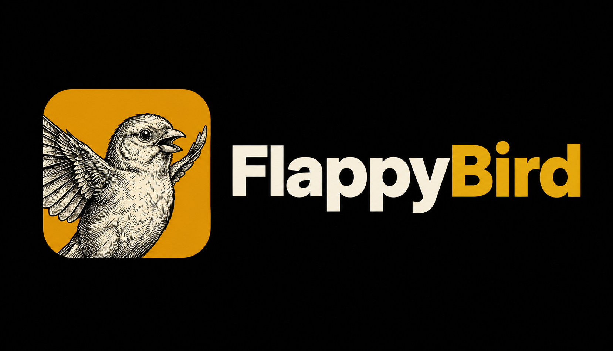</p>

<p align="center">Jogo de navegador inspirado em Flappy Bird, feito com JavaScript, HTML e CSS.</p>

<p align="center">


</p>


<p align="center"><a href="#visão-geral">Visão geral</a> &nbsp;·&nbsp; <a href="#recursos">Recursos</a> &nbsp;·&nbsp; <a href="#como-executar">Como executar</a></p>


<a id="explore-o-projeto"></a>

<a id="por-onde-começar"></a>

<p>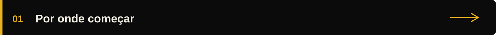</p>


- **[Página](Flappy-Bird-main/index.html)** — Estrutura da página do jogo.
- **[Jogo](Flappy-Bird-main/script.js)** — Lógica e interação em JavaScript.
- **[Elementos visuais](Flappy-Bird-main/images)** — Sprites, cenário e imagens da interface.


<a id="visão-geral"></a>

<a id="sobre-o-projeto"></a>

<p>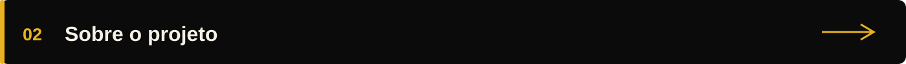</p>

Todos os recursos gráficos clássicos — cenário de fundo, pássaro, canos superiores e inferiores, logotipo e tela de *Game Over* — estão organizados localmente na pasta Flappy-Bird-main/images/, permitindo executar o jogo imediatamente em qualquer navegador moderno.

<a id="recursos"></a>


<p>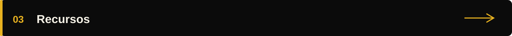</p>

**Loop de jogo contínuo**<br>
Atualização quadro a quadro da posição vertical do pássaro e do deslocamento horizontal dos canos.

**Física de voo e gravidade**<br>
Aceleração constante para baixo compensada pelo impulso instantâneo acionado pelo jogador.

**Obstáculos dinâmicos**<br>
Pares de canos (toppipe.png e bottompipe.png) gerados com aberturas variáveis ao longo da partida.

**Detecção de colisão**<br>
Verificação geométrica entre as coordenadas do pássaro, os limites da tela e os canos ativos.

**Sistema de pontuação**<br>
Incremento automático do placar a cada par de obstáculos superado com sucesso.

**Fluxo de reinício**<br>
Tela de início com botão interativo e transição imediata para nova tentativa após o *Game Over*.

<a id="tecnologias"></a>


<p>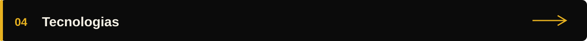</p>

- **JavaScript (script.js)** para o game loop, eventos de teclado/clique, física e placar;
- **HTML5 (index.html)** para estruturação do palco do jogo;
- **CSS3 (style.css)** para estilização, posicionamento e responsividade do container;
- **Sprites PNG** dedicados para todos os elementos visuais da partida.

<a id="arquitetura"></a>

<p></p>


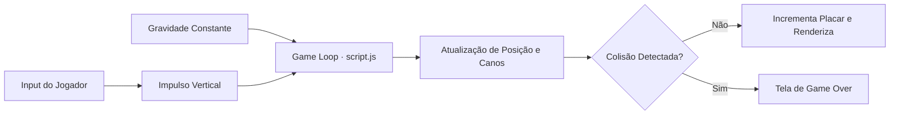


<a id="estrutura-do-repositório"></a>

<p>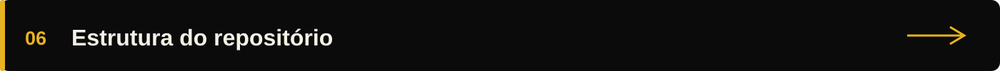</p>


```text
FlappyBird-Game/
├── assets/
│   └── identity/banner.png               Banner do projeto
├── Flappy-Bird-main/
│   ├── images/                         Sprites do pássaro, canos, cenário e UI
│   ├── index.html                      Página principal do jogo
│   ├── style.css                       Estilos e dimensões da área de jogo
│   └── script.js                       Motor de física, colisão e pontuação
└── README.md
```


<a id="como-executar"></a>


<p>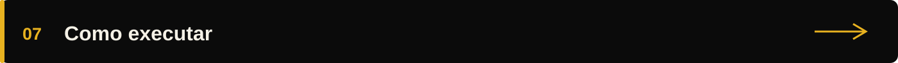</p>

1. Clone o repositório:
   ```bash
   git clone https://github.com/arthurlynow098/FlappyBird-Game.git
   ```
2. Abra o arquivo Flappy-Bird-main/index.html diretamente no navegador (ou utilize a extensão *Live Server* no VS Code).
3. Pressione a tecla de espaço / seta para cima para controlar a altitude do pássaro e desviar dos canos.

<a id="decisões-técnicas"></a>


<p>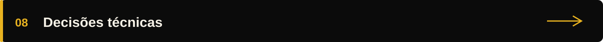</p>

- **Zero dependências externas:** toda a lógica de colisão e animação foi escrita em JavaScript nativo para manter o carregamento instantâneo e evidenciar os fundamentos da linguagem.


<p align="center">
  <a href="https://github.com/arthurlynow098">GitHub</a> &nbsp;·&nbsp;
  <a href="https://arthurentsev.vercel.app/">Portfólio</a> &nbsp;·&nbsp;
  <a href="https://www.linkedin.com/in/entsevarthur/">LinkedIn</a>
</p>


<a id="identidade-e-créditos"></a>

<p>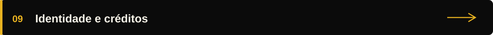</p>

<table><tr><td width="150">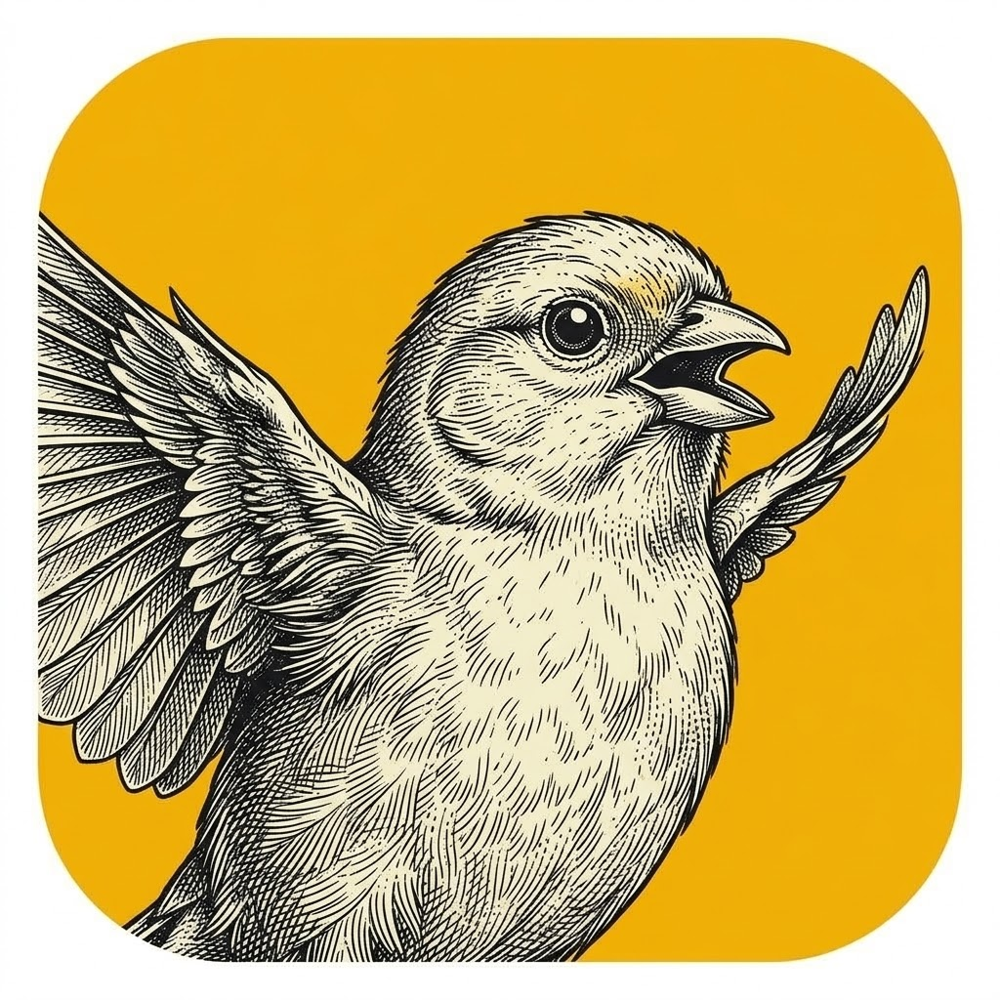</td><td><strong>Pardal</strong><br>Voo e movimento, elementos centrais do jogo.<br><br><a href="assets/identity-v2/logo.png">Logo em PNG</a> · <a href="assets/identity-v2/banner.png">Banner em PNG</a></td></tr></table>

Artes da coleção fornecida por **Arthur Entsev**, com adaptação das logos e acabamento dos banners realizados com auxílio de geração de imagens. Referências de identidade e apresentação: [LynowCut](https://github.com/arthurlynow098/LynowCut), [LynowMic](https://github.com/arthurlynow098/LynowMic) e [LynowCatch](https://github.com/arthurlynow098/LynowCatch). Os créditos e avisos do conteúdo original foram preservados.

<p align="center"><a href="#top">Voltar ao topo ↑</a> · <a href="https://github.com/arthurlynow098">Arthur Entsev</a> · <a href="https://arthurentsev.vercel.app/">Portfólio</a></p>
